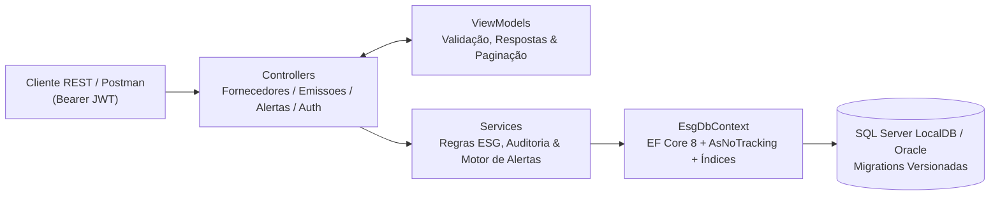

# ESG Supply Chain API (.NET 8) — Governança e Conformidade na Cadeia de Suprimentos


**Autor:** Renan Santa Rosa Xavier — RM566997 | **Portfólio:** [renan-xavier.vercel.app](https://renan-xavier.vercel.app)

---

## Visão Geral

Webservice RESTful desenvolvido em **ASP.NET Core 8** para o tema **Transparência na Cadeia de Suprimentos (ESG — Tema 6)**, evoluindo a API de rastreamento de emissões de carbono de **Escopo 3** e auditoria socioambiental de fornecedores corporativos.

Além do gerenciamento de fornecedores por elos da cadeia (`TIER_1`, `TIER_2`, `TIER_3`) e da auditoria de relatórios periódicos (`tCO2e`), esta versão em .NET 8 introduz:
- **Teto anual contratual de carbono por fornecedor** com cálculo percentual em tempo real;
- **Motor reativo de alertas socioambientais** (disparo preventivo em 80% da meta, violação crítica acima de 100% e bloqueio por ausência de certificação de direitos humanos);
- **Painel consolidado da cadeia** e encerramento rastreável de alertas mediante **plano de mitigação**.

---

## Especificação SDD (Spec-Driven Development)

O projeto foi concebido e guiado por especificação antes da implementação. Os artefatos completos estão em [`docs/sdd/`](./docs/sdd):

- [`constitution.md`](./docs/sdd/constitution.md) — Stack, regras arquiteturais MVVM, critérios de qualidade e governança.
- [`spec.md`](./docs/sdd/spec.md) — Problema, histórias de usuário, requisitos funcionais (`RF-01` a `RF-07`) e regras de negócio (`RN-01` a `RN-07`).
- [`plan.md`](./docs/sdd/plan.md) — Decisões técnicas (`D-01` a `D-08`), modelo relacional, contratos REST e riscos.
- [`tasks.md`](./docs/sdd/tasks.md) — Matriz de tarefas rastreáveis (`T-01` a `T-12`).

---

## Arquitetura MVVM na Web API



---

## Principais Endpoints

| Método | Rota | Acesso | Descrição |
| :---: | :--- | :---: | :--- |
| `POST` | `/api/auth/token` | Público | Emite token JWT Bearer (`Auditor` ou `Analista`) |
| `GET` | `/api/auth/perfis` | Público | Lista os perfis operacionais suportados |
| `GET` | `/api/fornecedores` | Público | Listagem paginada com filtros por `nivelCadeia`, `pais` e risco trabalhista |
| `POST` | `/api/fornecedores` | Analista / Auditor | Cadastra fornecedor com meta anual (`tCO2e`) |
| `PUT` | `/api/fornecedores/{id}` | Analista / Auditor | Atualiza fornecedor e reavalia alertas ativos |
| `GET` | `/api/fornecedores/{id}/conformidade` | Público | Diagnóstico completo de conformidade ESG e uso da meta anual |
| `GET` | `/api/emissoes` | Público | Listagem paginada de emissões ativas por fornecedor e status |
| `POST` | `/api/emissoes` | Analista / Auditor | Registra emissão de Escopo 3 e aciona gatilho de alertas (80% / 100%) |
| `PATCH` | `/api/emissoes/{id}/auditoria` | Auditor | Aprova (`AUDITADO`) ou reprova (`REJEITADO`) relatório submetido |
| `DELETE` | `/api/emissoes/{id}` | Auditor | Inativa logicamente relatório mantendo histórico de auditoria |
| `GET` | `/api/alertas` | Público | Listagem paginada de alertas por severidade e status de resolução |
| `GET` | `/api/alertas/painel-cadeia` | Público | Indicadores executivos consolidados de toda a cadeia |
| `PATCH` | `/api/alertas/{id}/resolver` | Auditor | Registra plano de mitigação e encerra o alerta |

---

## Como Executar Localmente

### 1. Restaurar pacotes, aplicar Migrations e rodar a API
```bash
dotnet restore
dotnet ef database update --project src/EsgSupplyChain.Api
dotnet run --project src/EsgSupplyChain.Api --urls "http://localhost:5080"
```
Documentação interativa Swagger disponível em: `http://localhost:5080/swagger`

### 2. Executar Testes Automatizados (xUnit)
```bash
dotnet test
```

### 3. Build via Docker
```bash
docker build -t esg-supplychain-dotnet8 .
```

### Credenciais Operacionais para Emissão de Token (`/api/auth/token`)
- **Auditor:** `auditor` / `esg-auditor-2026`
- **Analista:** `analista` / `esg-analista-2026`
